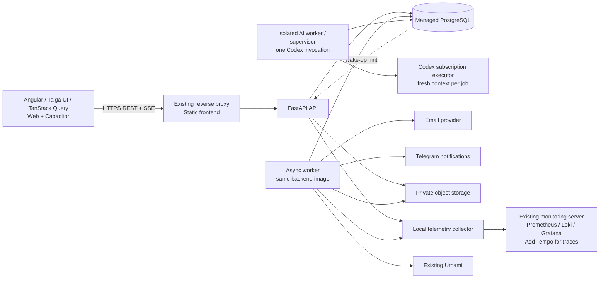

# System architecture

Status: proposed implementation baseline, 6 November 2026. These are design decisions, not a claim that the components are implemented or deployed. The executable foundation currently contains an Angular shell and FastAPI health/readiness endpoints.

The external `Study_Partner_MVP_Design_Specification.docx` and the owner's latest decisions take precedence over the archived hackathon specification. Pilot: APU, Malaysia; free individual connections; reusable goals, discovery, explicit requests, chat, feedback and safety controls. Interface language: English. Peerly is the approved product name.

## 1. Recommended shape

A modular monolith, one PostgreSQL database, one backend image with separate API, delivery worker and isolated AI executor processes. REST handles commands and queries. A single authenticated SSE connection per active client session delivers change notifications when chat/requests are implemented. No Socket.IO, Redis, Kafka, microservices or general event-sourcing framework for the pilot.



The frontend owns interaction, presentation, forms, navigation, accessibility, device integration and recovery. The backend owns eligibility, permissions, ranking, transitions, quotas, timing, idempotency and persisted truth. This is a typed application client, not a server-defined UI renderer: templates, Taiga components and layout stay in Angular.

## 2. Module boundaries

| Capability               | Server responsibilities                                                              | Representative use cases                                    |
| ------------------------ | ------------------------------------------------------------------------------------ | ----------------------------------------------------------- |
| Identity                 | Approved university domains, email challenges, sessions, actual registration records | StartEmailChallenge, VerifyEmailChallenge, RevokeSession    |
| Profiles and goals       | Required photo, visibility, one active goal, help subjects                           | SaveProfile, SaveGoal, CompleteGoal, HideProfile            |
| Discovery                | Eligibility first, deterministic relevance, passes, honest reasons                   | GetDiscovery, PassCandidate, RestorePassedCandidate         |
| Requests and connections | Pair uniqueness, immutable snapshots, limits, acceptance and cooldowns               | SendRequest, AcceptRequest, DeclineRequest, WithdrawRequest |
| Conversations            | One thread per pair, authorized messages, drafts' server acknowledgements            | ListMessages, SendMessage, ShareGoal                        |
| Feedback                 | Eligibility, latest assessment per pair, honest aggregates                           | ReportStudyOutcome, SaveFeedback                            |
| Safety and support       | Blocks, reports, restrictions, support cases                                         | BlockUser, ReportContent, OpenSupportCase                   |
| Operations               | Full privileged inspection of application data and relationships, audited access     | InspectAccount, InspectConversation, InspectEvent           |
| Delivery and analytics   | Durable tasks, change notifications, canonical events, external delivery             | ProcessDelivery, RecordClientEvents                         |

Keep these capabilities inside the clean layers already established: `domain`, `application`, `infrastructure`, `presentation`; compose concrete dependencies only in `bootstrap`. Introduce capability folders as code appears. Do not create empty repositories, services or protocols for every cell in this table. Use-case services have a specific responsibility; no generic CRUD base service or repository.

Domain invariants are pure. Application use cases consume immutable commands and async ports, establish transaction boundaries and return typed results. SQLAlchemy models and provider SDKs stay inside adapters. HTTP and background workers are two entrypoints into application behavior, not two implementations of it.

## 3. Thin frontend contract

Server read models include resource versions, state, relevant limits and explicit capabilities such as `can_send_request`, `can_accept`, `can_message`, and stable reason codes. Angular renders these and maps reason codes to reviewed English copy. These are helpful projections, never authorization tokens; the backend rechecks on every command.

Only local validation is duplicated for immediate feedback: required fields, format and display length. The server remains authoritative about versions, eligibility, rates and relationships. No client-side matching, role inference, quota arithmetic, feedback aggregation or hidden-state reconstruction.

Server data lives in TanStack Query. URL state stays in the router, editable drafts in typed forms, and unavoidable UI state in signals. A failed send preserves the draft and operation ID; reconnecting does not silently resend a social action. Clear private query data, drafts, analytics identity and stream state on logout/account change. Device-persisted chat drafts, when implemented, are account-scoped and excluded from analytics.

A transport event invalidates exact query keys or applies a version-checked cache update; it never creates another store. Explicit cache clearing is required when hiding/blocking/deletion makes previously visible data unavailable. HTTP streaming is a small transport adapter, not a new state-management layer.

## 4. Commands and durability

```mermaid
sequenceDiagram
    actor Student
    participant UI as Angular
    participant API as FastAPI / use case
    participant DB as PostgreSQL
    participant Worker
    Student->>UI: Confirm Send request
    UI->>API: POST request + idempotency key + action context
    API->>DB: Begin; lock; authorize; validate version/limits
    API->>DB: Write request + snapshot + events + delivery tasks
    DB-->>API: Commit
    API-->>UI: Canonical result and current capabilities
    UI->>UI: Update/invalidate query cache
    DB-->>API: Optional NOTIFY wake-up
    API-->>UI: SSE change hint for authorized recipient
    Worker->>DB: Claim committed external-delivery task
    Worker->>Worker: Deliver notification / analytics with retry
```

No external email, Telegram, analytics or AI call occurs inside a business transaction. Domain changes and their durable event/delivery records commit together; mandatory identified analytics projections are staged with committed outcomes. Exporter outages cannot undo a successful request or message. Business events are not the source from which account state is rebuilt: this is an ordinary relational application with a transactional outbox.

One AsyncSession per task/transaction. Pair operations serialize on a canonical relationship row. Lock accounts in stable ID order before pair rows; take any recipient stream-counter locks last, also in stable order. This lets hide/block/send/accept make a consistent eligibility decision. Use unique constraints as the final guard, not just preflight SELECTs. See [database design](database.md).

Idempotency is scoped to authenticated actor and operation. Persist a canonical payload fingerprint and result atomically. The same key with different input is rejected; retry after an ambiguous connection failure returns the previous outcome. A stale goal snapshot requires a refreshed preview and another explicit confirmation. Opposite sends resolve to the existing incoming request and do not silently accept it.

## 5. REST and change delivery

Product API: `/api/v1`; existing `/api/health` and `/api/ready` remain operational endpoints. OpenAPI is the contract; generate readonly TypeScript DTOs when product schemas exist, keeping generation reproducible and generated code separate from handwritten logic. No handwritten duplicate server DTOs. See [API design](api.md).

SSE is selected for one-way updates because sending already uses REST. It starts with the first live request/chat feature, not as a replacement for ordinary reads. One stream multiplexes request, conversation, visibility and unread changes. No typing, online presence or read-receipt protocol is required by the pilot.

Persist short-lived per-user event notifications with an ordered resume cursor. Never rely on in-memory queues or PostgreSQL NOTIFY as durable delivery. On resume, query persisted notifications; expired cursors trigger an explicit reset and query refetch. Reconnects have bounded backoff/jitter; foreground return refetches authoritative queries even if no gap was reported. A session's lifetime is not one enormous trace.

When available, use one dedicated asyncpg LISTEN connection per API process to wake up local streams, followed by normal short database reads. Register LISTEN before catch-up, and periodically reconcile so a lost wake-up cannot lose state. No database transaction/session remains open for the lifetime of a browser stream. PostgreSQL documents commit-time notification behavior and the initial LISTEN race. [NOTIFY](https://www.postgresql.org/docs/current/sql-notify.html), [LISTEN](https://www.postgresql.org/docs/current/sql-listen.html).

Managed database compatibility is an implementation gate: PgBouncer transaction pooling does not support LISTEN. Use a direct/session-pooled listener URL if available; otherwise use bounded periodic database reconciliation. Ordinary REST polling remains a client fallback when the transport is unavailable. Do not add Redis just to avoid verifying the provider's pooler. [PgBouncer feature map](https://www.pgbouncer.org/features.html).

Browser same-origin sessions can use cookie-authenticated EventSource. Native bearer authentication requires a streaming adapter that supports headers; never put credentials in stream URLs. Verify WebView streaming/cancellation on Android/iOS before native release; use polling if a runtime cannot reliably stream. Reverse proxy must disable buffering for SSE, send heartbeats, and allow a longer idle timeout. Bounded per-client queues close slow clients, which resume from the durable cursor.

WebSockets/Socket.IO become a separate decision only when actual bidirectional features or measured delivery constraints justify them. Incremental AI text streaming is optional future behavior with its own cancellation and draft semantics; do not add it to mandatory commands.

## 6. Identity and media

Google OIDC authenticates signup/signin; a separate emailed code confirms control of an institutional mailbox. University Microsoft SSO is outside MVP. Persist Google issuer/subject separately from the unique verified institutional email. Unverified sessions have no social/AI product capabilities. OTP verification binds membership to the already-authenticated account and never creates a login session. The owner-confirmed student email domain is exactly `mail.apu.edu.my`; do not implicitly allow other APU domains or subdomains. Challenges have bounded attempts, expiration/resend rules, rate limiting and keyed one-way code verification. If code delivery is deferred to the worker, use a short-lived encrypted delivery envelope with expiry/cleanup and a separately managed key; a hash alone cannot be turned back into the code to send. Such authentication delivery material is never a product event or log field. The browser uses host-only Secure HttpOnly session cookies, origin/CSRF validation for writes, and a same-origin API. Sessions can be revoked on logout.

Native authentication is an adapter for the same account/session use cases: short-lived access credentials and rotated refresh credentials in audited OS-backed secure storage. Do not use localStorage or Capacitor Preferences for secrets. Specify the final native token protocol when native authentication is implemented; do not assume web cookie behavior is identical in WebViews.

PostgreSQL stores file metadata and ownership; private object storage stores photos and attachments. Use the owner's external S3-compatible storage. Credentials and endpoint/bucket details will be supplied nearer deployment; region, limits and backup policy still require inventory. Do not store user files in container writable layers or publish a bucket.

Uploads are server-authorized and size-limited, with validated file signatures and bounded image dimensions. A worker handles conversion/metadata stripping with bounded CPU offload, never on the API event loop. Files become visible only after processing succeeds. Reads recheck current account/pair access; URLs are short-lived or served through an authorized media endpoint. Hiding/blocking also invalidates access, subject to the explicitly documented short lifetime of any previously issued URL.

## 7. Privileged inspection and telemetry

Grafana is internal to the owner and developers; all team members may view its dashboards without further per-dashboard or per-user restrictions. Product users and anonymous visitors have no Grafana access.

A distinct privileged operator interface/API has exhaustive access to application records and their relationships, including full conversations and attachments when needed. Links from analytics identify accounts/actions/resources and open that interface. No support-case restriction is imposed on this privileged inspection role. This owner decision supersedes the source specification's case-scoped browsing restriction for ordinary moderators; ordinary student and moderation APIs retain their own authorization semantics.

Record operator identity, targets, time and request/trace context for inspection actions. Do not copy inspected content into the access audit. Raw messages stay in business storage, not Loki/Tempo/Umami. Expired telemetry is shown as expired, not as missing business records. See [observability and data access](observability.md).

## 8. Deployment and implementation order

Use the existing VPS/Portainer and managed PostgreSQL. Keep monitoring on the existing monitoring server; add a trace store and a local collector/forwarder. Approved web hostname: `peerly.aleksei-orlov.dev`; API remains same-origin under `/api/v1` per the existing baseline. No DNS or infrastructure changes have been made. See [deployment design](deployment.md).

1. Establish the current operator/data-location/provider inventory; implement telemetry context and baseline health metrics with no private request capture.
2. Implement identity/profile/goal use cases, migrations, REST schemas and generated client types, with unit/PostgreSQL/browser screenshot tests.
3. Implement request state machine, idempotency and concurrency first; add the transaction/outbox primitives required by those use cases.
4. Implement conversations, per-user change stream and reconnect recovery; test real API + stream across two accounts.
5. Add safety/support, privileged inspection and complete audit; connect the bot and monitoring dashboards through provisioned configuration.
6. Validate staging deployment, migration/recovery, operational dashboards, privacy notices and full pilot scenarios before recruitment.

Every stage preserves a complete working path. Infrastructure integration and rollout remain pending actual access/configuration; no external changes have been made.

## 9. Required MVP AI delivery

Owner decision, 7 November 2026: AI assistance is included in MVP through a single subscription-authenticated Codex executor, not direct model API calls. Ship goal clarification, catalogue suggestions, advisory photo quality and internal report prioritisation. Core actions remain independent of AI availability. A bounded PostgreSQL job queue, separate resource-limited worker, global singleton execution, expiry/retry/circuit controls and typed result validation isolate AI overload. See [AI design](ai.md) for the complete contract and [backend roadmap](planning/backend-roadmap.md) for implementation order. Replace only the provider adapter after MVP. No live executor is configured.

Authentication details and the owner-confirmed Google-plus-mailbox flow supersede older email-code-only descriptions; see [BE-01](planning/epic-be-01-identity.md). Mail delivery needs only a configured outbound sender, not Microsoft Graph or access to student mailboxes.

## 10. Approved account and policy lifecycle

Follow [approved product decisions](planning/product-decisions-v1.md): hidden profiles keep existing chats working; Undo is 10 seconds; user deletion is soft delete with all accumulated history retained, sessions revoked and public identity replaced by Deleted account. Administrator ban is distinct. Registration has inline Terms/Privacy links only; mandatory identified analytics has no opt-out. Updates are informational without reacceptance. Versioned records describe actual registration/notice events, never fabricated explicit consent. Preserve history internally, enforce deletion/ban in every ordinary command/query/stream, and keep privileged original data inspectable.
