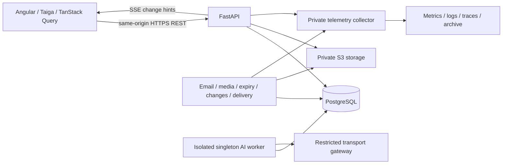

# System architecture

Peerly is an asynchronous modular monolith with separate API/background processes,
PostgreSQL persistence and a mobile-first Angular client. See [product](product.md)
for policy and [deployment](deployment.md) for operational boundaries.

## Responsibilities

The client owns presentation, navigation, accessible forms, explicit actions and
honest loading/recovery. Backend use cases own eligibility, quotas, ranking,
permissions, state transitions, timing, idempotency and durable truth. REST is the
command/query contract; SSE provides bounded version/invalidation hints and never
replaces authoritative reads. No extra broker or Socket.IO is required.

Frontend code is colocated by screen. Prefer simple WET code; lift shared logic
only after more than two real consumers need it. TanStack Query holds server
state, with small readonly signal state only for unavoidable local interaction.
Do not duplicate cached server data or create a second client business engine.
All styling goes through supported Taiga mechanisms and scoped theme contracts.

Backend layers depend inward: presentation→application→domain. Infrastructure
implements narrow ports; bootstrap composes concrete adapters. Domain/application
use immutable typed data and contain no web, SQL, storage or SDK dependency.
Persistence is async SQLAlchemy/asyncpg with typed Mapped/mapped_column models;
Alembic alone performs schema changes. One AsyncSession per task/transaction.

## Consistency and access

Commands use actor-bound immutable idempotency keys, actual source versions and
transactional source/canonical/outbox writes. Account locks precede sessions;
social pairs use sorted participant order. Finality uses DB time and explicit
outcome recovery, not client clocks, optimistic assumptions or expired leases.

Read and write units differ deliberately. Safe readers may share identity locks;
writing commands, audit/disclosure writes and photo-resume expiry retain writing
transactions. No SQL connection/permission lock is held over storage/model I/O;
source/permission checks repeat before releasing sensitive bytes or final results.

Google login, institutional membership, registration, activation, lifecycle and
operator role are distinct authorities. Existing chat membership independently
authorises minimal participant identity; discovery access cannot freeze accepted
chats or grant original/historical photos. Privileged inspection is audited and
never copies private content to ordinary logs.

## Background isolation

API, email/media/request-expiry/change/delivery workers have explicit lifecycles,
bounded connections, cancellation and health signals. Durable PostgreSQL jobs and
outboxes survive retries; network calls do not hold transactions. Delivery creates
no fictional receipt and provider acceptance is not proof of inbox placement.

AI uses a dedicated admission pool and singleton worker/heartbeat connection,
separate from core API capacity. Its bounded native execution, credential ownership,
physical cleanup and source revalidation are detailed in [AI](ai.md). Observability
uses owned providers/cached callbacks, not hidden SQL or global instrumentation.
